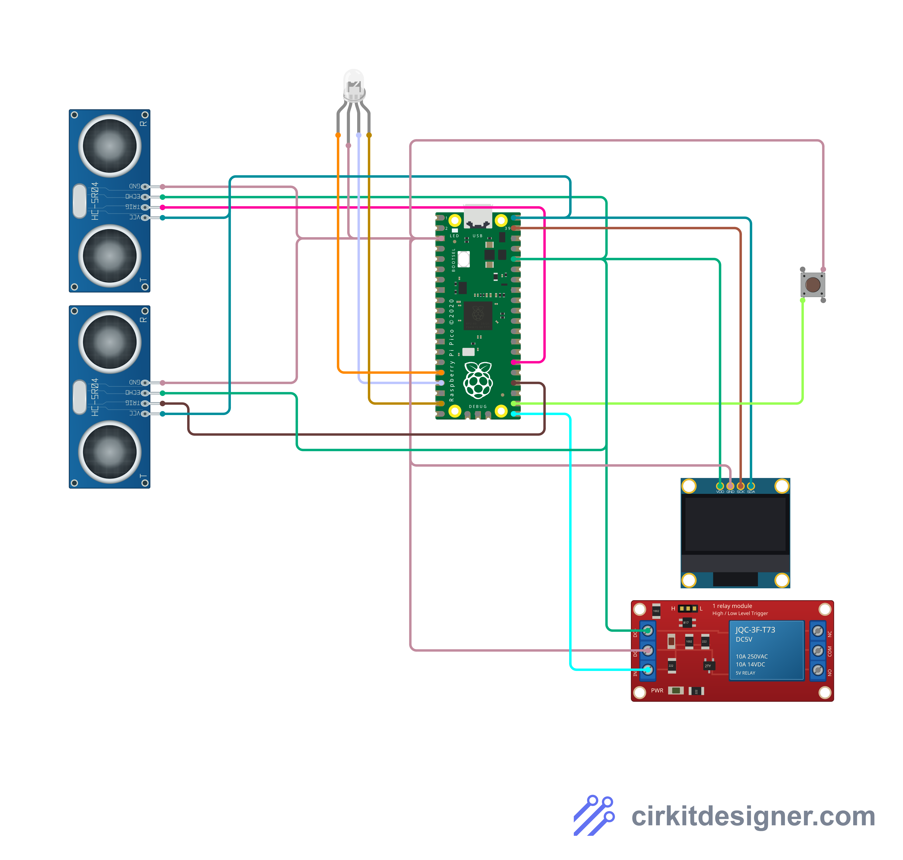

# DE2 Ultrasonic distance instrument
Ultrasonic sensors, serial 4-digit display, or Nokia SPI display  
#### Autoři:
* Samuel Barák
* Daniel Blumaier
* Samuel Breza
* Denis Bureš

### Zadání:
Projekt, ve kterém se pomocí dvou ultrazvukových senzorů a displeje vytvoří zařízení, které v pravidelných intervalech měří vzdálenost a ukazuje ji na displeji. Zároveň poskytuje vizuální i zvukovou indikaci toho, zda je objekt blízko, nebo daleko. Podobně jako bezpečnostní kamera navíc zaznamenává události (změny zóny, příchod a odchod objektu a pravidelná měření) s přesným časem a přes Wi-Fi je odesílá do cloudu ThingSpeak.

## Využité součástky
* Projekt je vytvářen v **MicroPythonu** na desku **Raspberry Pi Pico W**

| **Komponenty** | **Počet** | **Funkce** |
| :---: | :---: | :---: |
| [HC‑SR04](https://cdn.sparkfun.com/datasheets/Sensors/Proximity/HCSR04.pdf) | 2 | Ultrazvukový senzor (2×, vlevo a vpravo), který vysílá ultrazvukové vlny. Podle doby, za kterou se vlna odražená od překážky vrátí, se vypočítá vzdálenost. Jeho výstup Echo má 5 V, proto ho dělič napětí 1 kΩ / 2 kΩ snižuje na 3,3 V, které snese Pico. |
| [Raspberry Pi Pico W](https://pip-assets.raspberrypi.com/categories/686-raspberry-pi-pico-w/documents/RP-008312-DS-2-pico-w-datasheet.pdf) | 1 | Řídí celé zařízení. Přes vestavěnou Wi-Fi odesílá do cloudu ThingSpeak záznam událostí, podobně jako bezpečnostní kamera: změny zóny, příchod a odchod objektu (s nejmenší vzdáleností a dobou přítomnosti) a pravidelné měření každou minutu, vše s časem přesným na sekundu. |
| [OLED Displej](https://robu-prod-media.s3.ap-south-1.amazonaws.com/uploads/2019/12/1.3-Inch-I2C-IIC-OLED-LCD-Module-4pin-with-VCC-GND-Blue-1.pdf) | 1 | Pro vizuální indikaci za pomoci zobrazení vzdáleností z obou senzorů, poslední zaznamenané události a stavu Wi-Fi a odesílání. |
| **Tlačítko** | 1 | Pro zapnutí a vypnutí senzorů. |
| [RGB LED](https://arwill.hu/forras/termek/kit-ek/ky-016-rgb-led-modul-506261.pdf) | Pro vizuální indikaci za pomoci svícení dané barvy (zelená = daleko, žlutá = středně, červená = blízko) a rychlosti blikání. |
| [Relé modul](https://dratek.cz/docs/produkty/0/579/1517442331.pdf) | 1 | Pro zvukovou indikaci za pomoci cvakání ve stejném rytmu, v jakém bliká LED. |
| **Rezistory (1kΩ a 2kΩ)** | 2 a 2 | Pro vytvoření děliče, který z 5 V udělá 3,3 V bezpečné pro piny Raspberry Pi Pico W |
* Ochrana: Ultrazvukový senzor HC-SR04 bude správně fungovat s napájecím napětím 5 V. Je proto připojený na pin *VBUS*. Signál, který je pak posílaný přes pin *ECHO* má taktéž 5 V nicméně piny Raspberry Pi Pico W zvládnou jen 3,3 V. Proto pomocí 2 rezistorů se vytvoří napěťový dělič 2/3, který napětí z 5 V sníží na 3,3 V.
## Schémata
* **Blokové schéma:** 

* **Schéma zapojení:** 

