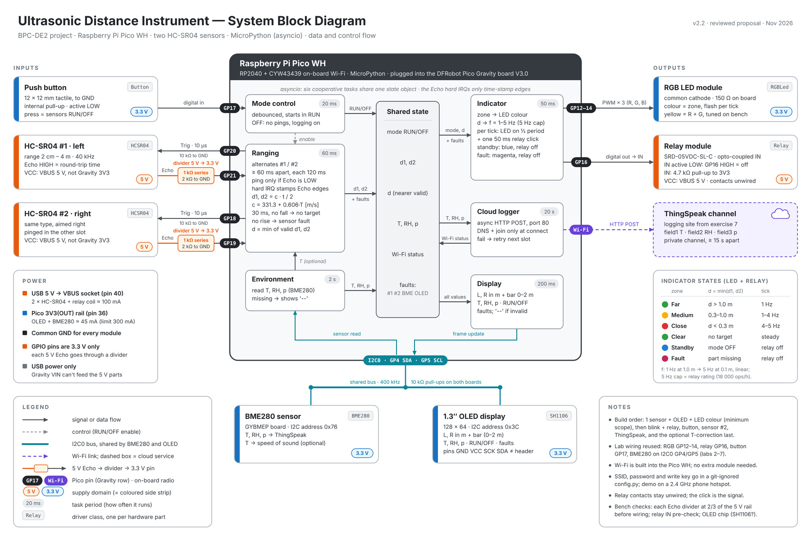

# DE2 Ultrasonic distance instrument
Ultrasonic sensors, serial 4-digit display, or Nokia SPI display  
#### Autoři:
* Samuel Barák
* Daniel Blumaier
* Samuel Breza
* Denis Bureš

### Zadání:
Projekt, ve kterém se pomocí dvou ultrazvukových senzorů a displeje vytvoří zařízení, které v pravidelných intervalech měří vzdálenost a ukazuje ji na displeji. Zároveň poskytuje vizuální i zvukovou indikaci toho, zda je objekt blízko, nebo daleko. Podobně jako bezpečnostní kamera navíc zaznamenává události (změny zóny, příchod a odchod objektu a pravidelná měření) s přesným časem a přes Wi-Fi je odesílá do cloudu ThingSpeak.

## Využité součástky
* Projekt je vytvářen v **MicroPythonu 1.29.0** na desku **Raspberry Pi Pico W**

| **Komponenty** | **Počet** | **Funkce** |
| :---: | :---: | :---: |
| [HC‑SR04](https://cdn.sparkfun.com/datasheets/Sensors/Proximity/HCSR04.pdf) | 2 | Ultrazvukový senzor (vlevo a vpravo), který vysílá ultrazvukové vlny. Podle doby, za kterou se vlna odražená od překážky vrátí, se vypočítá vzdálenost. Jeho výstup Echo má 5 V, proto ho dělič napětí 1 kΩ / 2 kΩ snižuje na 3,3 V, které snese Pico. |
| [Raspberry Pi Pico W](https://pip-assets.raspberrypi.com/categories/686-raspberry-pi-pico-w/documents/RP-008312-DS-2-pico-w-datasheet.pdf) | 1 | Řídí celé zařízení. Přes vestavěnou Wi-Fi odesílá do cloudu ThingSpeak záznam událostí, podobně jako bezpečnostní kamera: změny zóny, příchod a odchod objektu (s nejmenší vzdáleností a dobou přítomnosti) a pravidelné měření každou minutu, vše s časem přesným na sekundu. |
| [OLED Displej](https://robu-prod-media.s3.ap-south-1.amazonaws.com/uploads/2019/12/1.3-Inch-I2C-IIC-OLED-LCD-Module-4pin-with-VCC-GND-Blue-1.pdf) | 1 | Pro vizuální indikaci za pomoci zobrazení vzdáleností z obou senzorů, poslední zaznamenané události a stavu Wi-Fi a odesílání. |
| **Tlačítko** | 1 | Pro zapnutí a vypnutí senzorů. |
| [RGB LED](https://arwill.hu/forras/termek/kit-ek/ky-016-rgb-led-modul-506261.pdf) | 1 | Pro vizuální indikaci za pomoci svícení dané barvy (zelená = daleko, žlutá = středně, červená = blízko) a rychlosti blikání. |
| [Relé modul](https://dratek.cz/docs/produkty/0/579/1517442331.pdf) | 1 | Pro zvukovou indikaci za pomoci cvakání ve stejném rytmu, v jakém bliká LED. |
| **Rezistory (1kΩ a 2kΩ)** | 2 a 2 | Pro vytvoření děliče, který z 5 V udělá 3,3 V bezpečné pro piny Raspberry Pi Pico W |
| **Rezistory (10 kΩ)** | 2 | Z pinu Trig na GND: senzor má na Trig vlastní pull-up 10 kΩ na 5 V, takže pin Pica, který ho ještě neovládá (např. při startu), zůstane na bezpečných 2,5 V. |
| **Rezistory (4,7 kΩ)** | 3 | Pull-upy na 3,3 V pro vstup IN relé a pro linky SDA a SCL displeje. |
| **Kondenzátory (100 nF a 10–47 µF)** | 3 a 1 | Blokovací kondenzátory: 100 nF u napájení každého senzoru a relé, 10–47 µF navíc u relé. |
* Ochrana: Ultrazvukový senzor HC-SR04 bude správně fungovat s napájecím napětím 5 V. Je proto připojený na pin *VBUS*. Signál, který je pak posílaný přes pin *ECHO* má taktéž 5 V nicméně piny Raspberry Pi Pico W zvládnou jen 3,3 V. Proto pomocí 2 rezistorů se vytvoří napěťový dělič 2/3, který napětí z 5 V sníží na 3,3 V.
## Schémata
* **Blokové schéma:** 

* **Schéma zapojení (pin po pinu):** 

| **Modul** | **Zapojení** |
| :--- | :--- |
| HC‑SR04 #1 (vlevo) | VCC → 5 V (VBUS, pin 40), Trig → GP20 (pin 26) + 10 kΩ na GND, Echo → dělič 1 kΩ / 2 kΩ → GP21 (pin 27), GND → GND |
| HC‑SR04 #2 (vpravo) | VCC → 5 V (VBUS, pin 40), Trig → GP18 (pin 24) + 10 kΩ na GND, Echo → dělič 1 kΩ / 2 kΩ → GP19 (pin 25), GND → GND |
| Tlačítko | GP17 (pin 22) a GND (vnitřní pull-up, stisk = log. 0) |
| RGB LED | R → GP12 (pin 16), G → GP13 (pin 17), B → GP14 (pin 19), − → GND |
| Relé modul | DC+ → 5 V (VBUS, pin 40), DC− → GND, IN → GP16 (pin 21) + pull-up 4,7 kΩ na 3V3 |
| OLED displej | VCC → 3V3 (pin 36), GND → GND, SCL → GP5 (pin 7), SDA → GP4 (pin 6) + pull-upy 4,7 kΩ na 3V3 |

Senzory a relé jsou napájené z 5 V (VBUS, pin 40), OLED displej a pull-up rezistory z výstupu 3V3 Pica (pin 36). GND je kterýkoli černý pin, všechny země jsou spojené. Celé zařízení se napájí přes USB.

Dělič u výstupu Echo: *U* = 5 V · 2 kΩ / (1 kΩ + 2 kΩ) ≈ 3,33 V.

## Časování tasků
Program běží v knihovně `asyncio`: každý task se pravidelně probudí, udělá svou práci a zase se uspí, takže se tasky navzájem neblokují.

| **Task** | **Perioda** | **Co dělá** | **Proč tato perioda** |
| :--- | :---: | :--- | :--- |
| Tlačítko (`mode_task`) | 20 ms | Čte tlačítko, odfiltruje zákmity (40 ms) a zapíná nebo vypíná senzory. | Zákmity tlačítka trvají do 10 ms, takže 20 ms žádný stisk nepropásne; kurz doporučuje 20–50 ms. |
| Měření (`ranging_task`) | 60 ms | Střídavě spouští levý a pravý senzor, takže každý měří jednou za 120 ms. Hodnoty filtruje mediánem ze 3 měření, vybere bližší z obou vzdáleností a určí zónu. | Mezi dvěma pingy musí uplynout aspoň 60 ms, jinak senzor zachytí ozvěnu předchozího pingu nebo ping druhého senzoru. Každý senzor tak měří 8,3× za sekundu. |
| Detektor událostí | po každém měření | Zaznamená změnu zóny, příchod a odchod objektu (odchod až po 3 s bez objektu) a každých 60 s pravidelné měření. | Běží hned po měření, takže mu žádná změna neunikne. Odchod čeká 3 s, aby krátký výpadek měření nezaložil novou návštěvu. |
| Indikace (`indicator_task`) | 50 ms | Nastaví barvu LED podle zóny. LED blikne a relé cvakne (na 50 ms) 1–5× za sekundu: čím blíž objekt, tím rychleji. | Změna zóny se ukáže do 50 ms. Nejrychlejší rytmus je 5× za sekundu (perioda 200 ms), takže krok 50 ms stačí. |
| Displej (`display_task`) | 200 ms | Překreslí vzdálenosti, poslední událost a stav Wi-Fi. | 5 obnovení za sekundu stačí ke čtení. Celý obraz zabere na I2C asi 25 ms, proto se posílá po 8 částech (asi 3 ms) a ostatní tasky neblokuje. |
| Cloud (`logger_task`) | 20 s | Odešle nasbírané události do ThingSpeaku (nejdříve 15 s po minulém odeslání). Při výpadku zkouší Wi-Fi znovu po 10 s. Přesný čas bere z NTP po připojení a pak každých 6 h. | Bezplatný ThingSpeak přijme hromadné nahrání nejdříve 15 s po předchozím. Hodiny Pica se za den rozejdou až o několik sekund, NTP každých 6 h je drží zhruba na 1 s. |
| Přerušení od Echo | při každé hraně | Hardwarové přerušení jen uloží čas hrany v µs, vzdálenost z něj spočítá task měření. | Čas hrany potřebujeme přesně (1 µs ≈ 0,17 mm vzdálenosti) a obsluha přerušení má být co nejkratší, proto výpočet běží mimo ni. |

## MicroPython a využité knihovny
* **MicroPython 1.29.0** (firmware `RPI_PICO_W`)
* **Vestavěné moduly MicroPythonu:** `asyncio`, `machine` (`Pin`, `PWM`, `I2C`), `time`, `network` (Wi-Fi), `ntptime`, `socket`, `json`, `framebuf`, `micropython`, `sys`
* **Ovladač OLED displeje:** `sh1106.py` z projektu [robert-hh/SH1106](https://github.com/robert-hh/SH1106) (licence MIT)
* **Na počítači:** `mpremote` 1.29.0 (nahrávání do Pica), `mpy-cross` 1.29.0.post2 (kontrola kódu před nahráním), `pytest` 9.2.0 (testy na PC)

## Rozdělení práce v týmu
Na zapojení a testování pracujeme všichni společně na cvičeních. Za jednotlivé části odpovídají:

| **Člen týmu** | **Zodpovídá za** |
| :--- | :--- |
| Samuel Barák | návrh programu a propojení modulů do jednoho programu, testy; drobné průběžné úpravy repozitáře |
| Daniel Blumaier | plakát a prezentace včetně videa, fotky prototypu, doplňky navíc |
| Samuel Breza | hardware: zapojení na nepájivém poli, senzory s děliči napětí, displej, RGB LED, relé a tlačítko; měření přesnosti senzorů |
| Denis Bureš | větší úpravy repozitáře a dokumentace: README, dokumentace Sphinx, výsledky testů |
