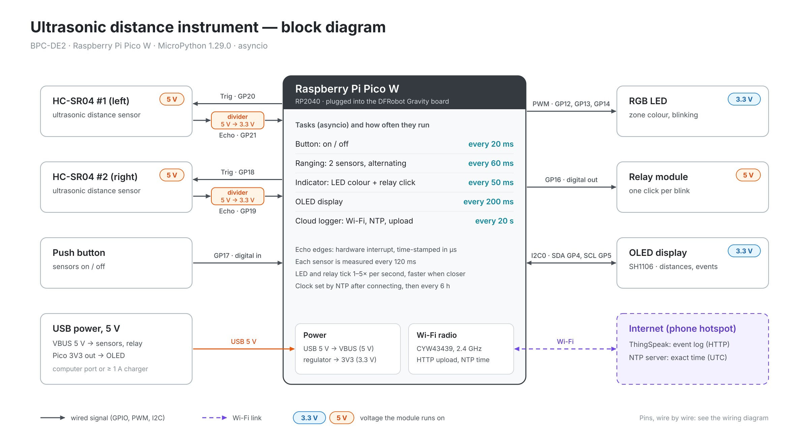
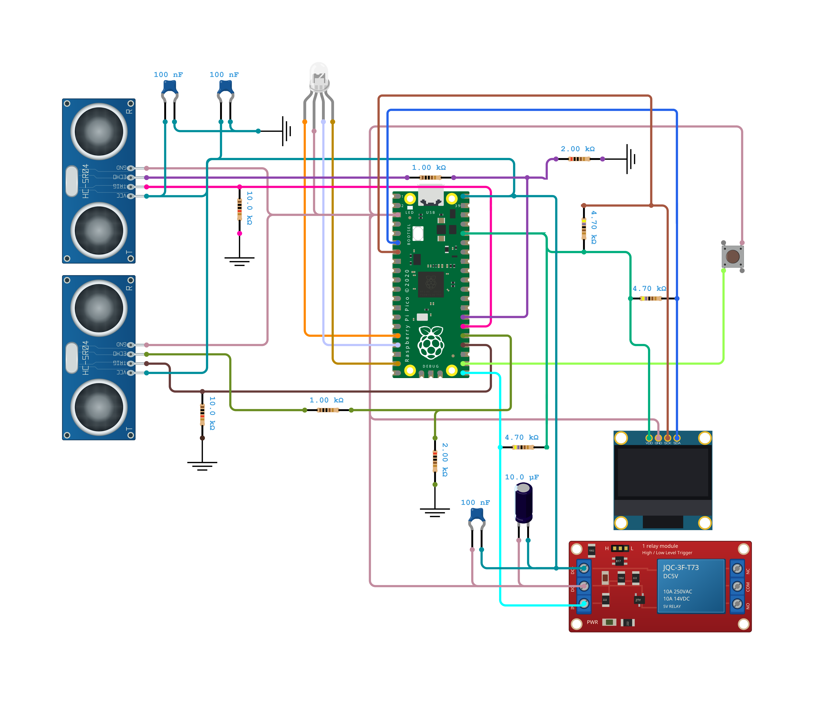
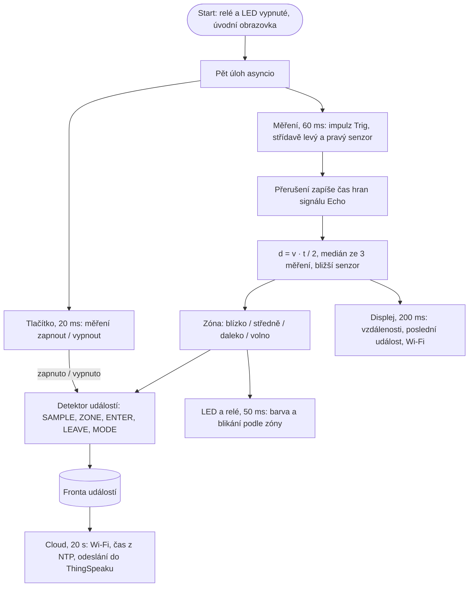

# Ultrazvukový měřič vzdálenosti
Projekt do předmětu BPC-DE2 na VUT FEKT (2026): Raspberry Pi Pico W v MicroPythonu se dvěma ultrazvukovými senzory, OLED displejem, RGB LED, relé a záznamem událostí do cloudu ThingSpeak.

## Autoři
* Samuel Barák
* Daniel Blumaier
* Samuel Breza
* Denis Bureš

## Zadání
Obyčejný měřič vzdálenosti ukáže jen aktuální hodnotu a nic si nepamatuje. Chtěli jsme přístroj, který navíc pozná, kdy se k němu něco přiblížilo, jak blízko to bylo a jak dlouho to zůstalo, a uloží si to s přesným časem, takže se to dá prohlédnout i později.

Projekt, ve kterém se pomocí dvou ultrazvukových senzorů a displeje vytvoří zařízení, které v pravidelných intervalech měří vzdálenost a ukazuje ji na displeji. Zároveň poskytuje vizuální i zvukovou indikaci toho, zda je objekt blízko, nebo daleko. Podobně jako bezpečnostní kamera navíc zaznamenává události (změny zóny, příchod a odchod objektu a pravidelná měření) s přesným časem a přes Wi-Fi je odesílá do cloudu ThingSpeak.

## Funkčnost
* Dva senzory (vlevo a vpravo) měří střídavě, každý 8× za sekundu. Každou hodnotu vyhladí medián ze tří posledních měření a dál se počítá s bližší z obou vzdáleností. Podle ní se určí zóna:

| **Zóna** | **Vzdálenost** | **Barevné svícení** |
| :--- | :---: | :---: |
| blízko | pod 0,3 m | červená |
| středně | 0,3–1,0 m | žlutá |
| daleko | nad 1,0 m | zelená |
| volno | nic v dosahu 4 m | zelená, svítí trvale |

* Hranice zón mají hysterezi 3 cm, aby barva na hranici nepřeskakovala. LED bliká a relé při každém bliknutí cvakne: od 1 m dál jednou za sekundu, a čím blíž, tím rychleji, až 5× za sekundu na 10 cm a blíž. Displej ukazuje vzdálenosti z obou senzorů, poslední událost a stav Wi-Fi.

| **Stav** | **Barevné svícení** |
| :--- | :---: |
| Vypnuté měření | modrá |
| Porucha senzoru nebo displeje | fialová |

Události se ukládají s časem z internetu (NTP) a každých 20 s se odešlou do ThingSpeaku:

| **Událost** | **Kdy vznikne** |
| :--- | :--- |
| `SAMPLE` | každou minutu, se současnými vzdálenostmi |
| `ZONE` | při změně zóny |
| `ENTER` | objekt je blíž než 1 m (dvě měření po sobě) |
| `LEAVE` | objekt je 3 s dál než 1 m nebo zmizel; zapíše se i nejmenší vzdálenost a doba přítomnosti |
| `MODE` | tlačítkem se měření zapnulo nebo vypnulo |

Kanál ThingSpeak má 7 polí:
* Vzdálenost
* Levý a pravý senzor (v metrech)
* Zóna
* Událost
* Nejmenší vzdálenost (m)
* Doba přítomnosti (s)

## Princip měření
Pico pošle na vstup *Trig* impulz dlouhý 10 µs. Senzor vyšle osm ultrazvukových pulzů o frekvenci 40 kHz a výstup *Echo* drží v log. 1, dokud se ozvěna od překážky nevrátí. Délka impulzu *Echo* je tedy doba *t*, za kterou zvuk doletí k překážce a zpět, proto se dělí dvěma:

$d = \frac{v \cdot t}{2}$

kde *v* = 343,4 m/s je rychlost zvuku ve vzduchu při 20 °C. Například *t* = 5,8 ms odpovídá vzdálenosti 1 m. Senzor měří zhruba od 2 cm do 4 m. Senzory se střídají po 60 ms, aby jeden nezachytil ozvěnu druhého.

## Využité součástky
* Projekt je vytvářen v **MicroPythonu 1.29.0** na desku **Raspberry Pi Pico W**

| **Komponenty** | **Počet** | **Funkce** |
| :--- | :---: | :--- |
| [HC‑SR04](https://cdn.sparkfun.com/datasheets/Sensors/Proximity/HCSR04.pdf) | 2 | Ultrazvukový senzor (vlevo a vpravo), který vysílá ultrazvukové vlny. Podle doby, za kterou se vlna odražená od překážky vrátí, se vypočítá vzdálenost. Jeho výstup Echo má 5 V, proto ho dělič napětí 1 kΩ / 2 kΩ snižuje na 3,3 V, které snese Pico. |
| [Raspberry Pi Pico W](https://pip-assets.raspberrypi.com/categories/686-raspberry-pi-pico-w/documents/RP-008312-DS-2-pico-w-datasheet.pdf) | 1 | Řídí celé zařízení. Přes vestavěnou Wi-Fi odesílá do cloudu ThingSpeak záznam událostí, podobně jako bezpečnostní kamera: změny zóny, příchod a odchod objektu (s nejmenší vzdáleností a dobou přítomnosti) a pravidelné měření každou minutu, vše s časem přesným na sekundu. |
| [Rozšiřující deska DFRobot Gravity (DFR0848)](https://wiki.dfrobot.com/dfr0848/) | 1 | Pico se do ní zasune a každý pin má vlastní trojici signál / 3V3 / GND, takže se moduly zapojují bez nepájivého pole. |
| [OLED displej 1,3″ (SH1106, I2C)](https://robu-prod-media.s3.ap-south-1.amazonaws.com/uploads/2019/12/1.3-Inch-I2C-IIC-OLED-LCD-Module-4pin-with-VCC-GND-Blue-1.pdf) | 1 | Pro vizuální indikaci za pomoci zobrazení vzdáleností z obou senzorů, poslední zaznamenané události a stavu Wi-Fi a odesílání. |
| **Tlačítko** | 1 | Pro zapnutí a vypnutí senzorů. |
| [RGB LED modul (KY-016)](https://arwill.hu/forras/termek/kit-ek/ky-016-rgb-led-modul-506261.pdf) | 1 | Pro vizuální indikaci za pomoci svícení dané barvy (zelená = daleko, žlutá = středně, červená = blízko) a rychlosti blikání. Rezistory pro LED jsou přímo na modulu. |
| [Relé modul](https://dratek.cz/docs/produkty/0/579/1517442331.pdf) | 1 | Pro zvukovou indikaci za pomoci cvakání ve stejném rytmu, v jakém bliká LED. |
| **Rezistory (1 kΩ a 2 kΩ)** | 2 a 2 | Pro vytvoření děliče, který z 5 V udělá 3,3 V bezpečné pro piny Raspberry Pi Pico W. |
| **Rezistory (10 kΩ)** | 2 | Drží vstup Trig na bezpečném napětí, dokud ho Pico při startu neovládá. |
| **Rezistory (4,7 kΩ)** | 3 | Pull-upy pro relé a pro I2C displeje. |
| **Kondenzátory (100 nF a 10–47 µF)** | 3 a 1 | Stabilizují napájení senzorů a relé. |

**Ochrana:** Senzor HC-SR04 spolehlivě funguje jen s napájením 5 V, proto je připojený na pin *VBUS*. Jeho výstup *Echo* má pak také 5 V, ale piny Raspberry Pi Pico W snesou jen 3,3 V. Dělič ze dvou rezistorů proto napětí sníží na dvě třetiny, tedy asi na 3,3 V.

## Schémata
**Blokové schéma:** 

**Schéma zapojení:** 

Zapojení pin po pinu, včetně čísel pinů a poznámek k napájení: [podrobné schéma](docs/img/ultrasonic_wiring_diagram.svg).

| **Modul** | **Zapojení** |
| :--- | :--- |
| HC‑SR04 #1 (vlevo) | VCC → 5 V (VBUS, pin 40), Trig → GP20 (pin 26) + 10 kΩ na GND, Echo → dělič 1 kΩ / 2 kΩ → GP21 (pin 27), GND → GND |
| HC‑SR04 #2 (vpravo) | VCC → 5 V (VBUS, pin 40), Trig → GP18 (pin 24) + 10 kΩ na GND, Echo → dělič 1 kΩ / 2 kΩ → GP19 (pin 25), GND → GND |
| Tlačítko | GP17 (pin 22) a GND |
| RGB LED | R → GP12 (pin 16), G → GP13 (pin 17), B → GP14 (pin 19), − → GND |
| Relé modul | DC+ → 5 V (VBUS, pin 40), DC− → GND, IN → GP16 (pin 21) + 4,7 kΩ na 3V3 |
| OLED displej | VCC → 3V3 (pin 36), GND → GND, SCL → GP5 (pin 7), SDA → GP4 (pin 6) + 4,7 kΩ na 3V3 |

* Senzory a relé běží z 5 V, displej z 3,3 V. Všechny země jsou spojené a celé zařízení se napájí přes USB. Dělič u Echo: *U* = 5 V · 2 kΩ / (1 kΩ + 2 kΩ) ≈ 3,33 V.

## Program
Program běží v `asyncio`: pět úloh se pravidelně probudí, udělá svou práci a zase uspí, takže žádná nezdržuje ostatní.

### Časování

| **Úloha** | **Jak často** | **Co dělá** |
| :--- | :---: | :--- |
| Tlačítko | 20 ms | Zapíná a vypíná senzory. Stisk trvá desítky milisekund, takže ho kontrola každých 20 ms vždy zachytí, a zákmity kontaktů (do 10 ms) mezi dvěma kontrolami odezní. |
| Měření | 60 ms | Střídá levý a pravý senzor, každý měří 8× za sekundu. Kratší odstup by zachytil ozvěnu předchozího měření. |
| Události | po každém měření | Zapíše změnu zóny, příchod a odchod objektu a jednou za minutu aktuální vzdálenosti. |
| LED a relé | 50 ms | Barva podle zóny, bliknutí a cvaknutí 1–5× za sekundu: čím blíž, tím rychleji. |
| Displej | 200 ms | Vzdálenosti, poslední událost a stav Wi-Fi. Obraz se posílá po částech, aby nezdržoval měření. |
| Cloud | 20 s | Pošle nové události do ThingSpeaku, který další data přijme nejdřív po 15 s. Čas si bere z NTP po připojení a pak každých 6 h. |
| Echo | při každé hraně | Přerušení jen zapíše čas hrany, vzdálenost spočítá úloha měření. |

## Software
* **MicroPython 1.29.0** (firmware `RPI_PICO_W`)
* **Vestavěné moduly:** `asyncio`, `machine`, `time`, `network`, `ntptime`, `socket`, `json`, `framebuf`, `micropython`, `sys`
* **Ovladač displeje:** `sh1106.py` od [robert-hh](https://github.com/robert-hh/SH1106) (licence MIT), ve složce [`src/lib`](src/lib/)
* **Ostatní moduly** ve složce [`src`](src/) vznikly pro tento projekt
* **Na počítači:** `mpremote` (nahrání programu do Pica a spouštění testů)

## Struktura repozitáře
* [`src/`](src/) – program, který se nahrává do Pica
  * [`main.py`](src/main.py) – start programu: bezpečně nastaví hardware a spustí úlohy
  * [`tasks.py`](src/tasks.py) – pět úloh `asyncio`: tlačítko, měření, LED a relé, displej, cloud
  * [`logic.py`](src/logic.py) – výpočty bez hardwaru: vzdálenost, filtr, zóny, události
  * [`state.py`](src/state.py) – stav sdílený mezi úlohami a fronta událostí
  * [`settings.py`](src/settings.py) – všechna čísla, která se dají nastavit (zóny, časy, barvy)
  * [`board.py`](src/board.py) – přiřazení pinů
  * [`hcsr04.py`](src/hcsr04.py), [`rgb_led.py`](src/rgb_led.py), [`relay.py`](src/relay.py), [`button.py`](src/button.py), [`display.py`](src/display.py) – ovladače součástek
  * [`wifi.py`](src/wifi.py), [`timesync.py`](src/timesync.py), [`thingspeak.py`](src/thingspeak.py) – Wi-Fi, čas z NTP a odesílání do ThingSpeaku
  * [`config_example.py`](src/config_example.py) – vzor souboru `config.py` s údaji pro Wi-Fi a ThingSpeak (`config.py` do gitu nepatří)
  * [`lib/`](src/lib/) – převzatý ovladač displeje
* [`tests/`](tests/) – krátké testy jednotlivých součástek na Picu
* [`tools/deploy.py`](tools/deploy.py) – nahraje obsah `src/` do Pica
* [`docs/img/`](docs/img/) – blokové schéma a schémata zapojení

## Testy součástek
Každý test je krátký skript, který vyzkouší jednu součástku. Nejdřív se do Pica nahraje `src/` (viz *Spuštění*), pak se test spustí z počítače, například `mpremote run tests/test_led.py`.

| **Test** | **Co dělá** |
| :--- | :--- |
| [`test_pico.py`](tests/test_pico.py) | Blikne LED přímo na Picu a zkontroluje, jak jsou zapojené vstupní piny. Spouští se jako první. |
| [`test_led.py`](tests/test_led.py) | RGB LED svítí zeleně, žlutě, červeně a modře, každou barvu 1 s. |
| [`test_relay.py`](tests/test_relay.py) | Relé pětkrát cvakne, jednou za sekundu. |
| [`test_button.py`](tests/test_button.py) | Po dobu 20 s vypíše každý stisk tlačítka. |
| [`test_display.py`](tests/test_display.py) | Najde displej na I2C a napíše na něj „Hello world.“. |
| [`test_sensors.py`](tests/test_sensors.py) | Dvakrát za sekundu vypíše vzdálenost z obou senzorů. |
| [`test_wifi.py`](tests/test_wifi.py) | Připojí se k Wi-Fi a nastaví čas z NTP; vypíše IP adresu a čas. |

Všechny testy prošly na sestaveném přístroji 26. 11. 2026. Celý program pak běžel se všemi součástkami a data se zapisovala do ThingSpeaku.

## Spuštění
1. Do Pica nahrajte firmware [MicroPython 1.29.0 pro Pico W](https://micropython.org/download/RPI_PICO_W/).
2. Zkopírujte [`src/config_example.py`](src/config_example.py) jako `src/config.py` a doplňte název a heslo Wi-Fi (2,4 GHz), číslo kanálu a zápisový klíč ThingSpeak. Soubor `config.py` je v `.gitignore`, takže se do gitu nedostane.
3. Na počítači spusťte `pip install mpremote` a pak `python tools/deploy.py`, který nahraje obsah `src/` do Pica.
4. Po resetu se program spustí sám. Když při resetu držíte tlačítko, start se přeskočí a Pico zůstane volné pro testy a vývoj.

## Využití AI
Při vývoji jsme používali AI asistenta Claude (Anthropic). Pomáhal nám navrhnout strukturu programu, psát a kontrolovat kód a testy, nakreslit blokové schéma a podrobné schéma zapojení a formulovat texty v tomto README. Zapojení, měření a testy na hardwaru děláme sami a navržený kód procházíme a upravujeme.

## Rozdělení práce v týmu
Na zapojení a testování pracujeme všichni společně.

| **Člen týmu** | **Na starosti** |
| :--- | :--- |
| Samuel Barák | návrh programu, propojení modulů a testy, drobné úpravy repozitáře |
| Daniel Blumaier | schéma zapojení, plakát, prezentace a video, fotky, doplňky |
| Samuel Breza | hardware: zapojení, senzory s děliči, displej, LED, relé a tlačítko; měření přesnosti |
| Denis Bureš | větší úpravy repozitáře a dokumentace (README, Sphinx, výsledky testů) |
